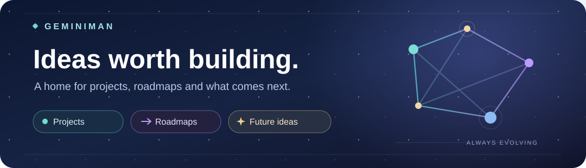

### A little space for everything I am building.

**[Visit GeminiMan.net](https://geminiman.net/)** &nbsp;·&nbsp; [Explore the projects](https://geminiman.net/#projects) &nbsp;·&nbsp; [See the roadmap](https://geminiman.net/#roadmap)

---

### Why this page exists

This repository has **one purpose**: to provide [GeminiMan.net](https://geminiman.net/) with the public content behind its **projects, roadmaps, development progress and future ideas**.

It is the website's little notebook. As I complete a milestone, revisit an idea or introduce a new project, I can update the information here so visitors can follow the journey on GeminiMan.net. This is **not** a separate app, download page or software source-code collection.

### Where things stand

| Right now | After that | Further ahead |
| :--- | :--- | :--- |
| **Wellness Companion**. Experimental blood pressure research is my main focus. Reliability and validation need time. | **A little pause**. Time to rest after the current research milestone. | **Back to the workshop**. More wellness features, WearOS Manager screen mirroring, Journal, Clock Chimes and other everyday tools. |

There are plenty of ideas, but no artificial countdowns. Plans may change, and experimental features are not promises of a release date.

### Enjoying the projects? Help keep them going.

I build and share these projects because I enjoy creating things that people can actually use. I try to keep my work accessible, without ads or mandatory subscriptions. If something I have made has been useful to you, **optional support helps me continue developing, testing and maintaining it**.

&nbsp;

&nbsp;

**No obligation, ever.** Trying the apps, sharing them with friends, reporting issues and sending suggestions are meaningful ways to help, too.

Thank you for being part of this journey.

<strong>Curious about how the website stays up to date?</strong>

The website reads two small public content files from this repository:

| Content | What visitors see |
| :--- | :--- |
| [`data/public-roadmap.json`](data/public-roadmap.json) | Projects, progress labels, milestones and future plans. |
| [`data/site-copy.json`](data/site-copy.json) | Introductions, project stories, quotes and support links. |

The site can use its own bundled copies if the GitHub content is temporarily unavailable. App downloads, privacy policies and the Google Play catalog are handled separately by GeminiMan.net.

Made with care for the community. · GeminiMan / XDA-Dante63

